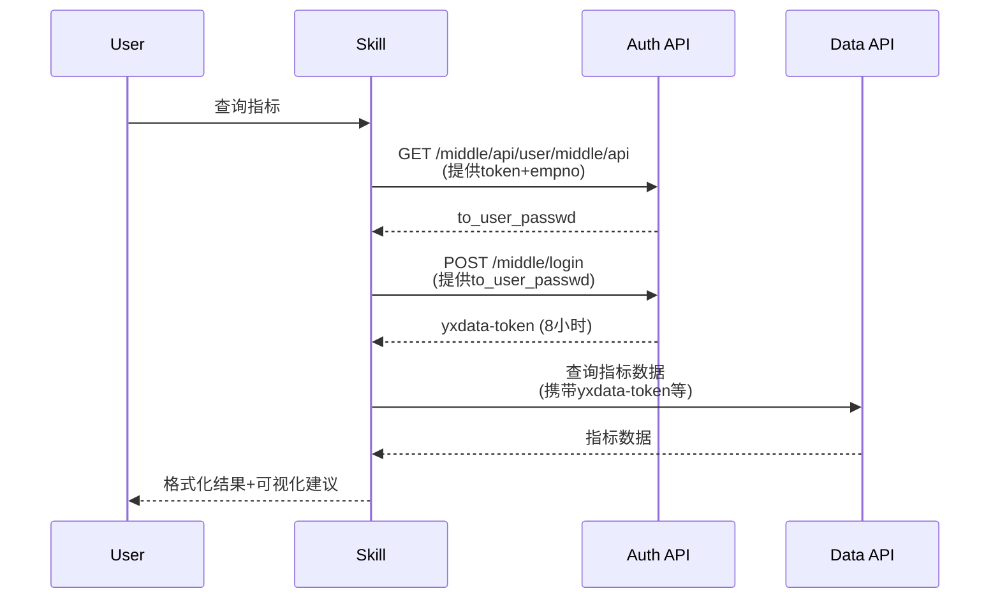

# IMAP API 接口详细文档

## 目录

1. [认证相关接口](#认证相关接口)
2. [查询接口](#查询接口)
3. [通用说明](#通用说明)

---

## 认证相关接口

### 1. 获取公共账户令牌

**接口说明**：使用用户token获取公共账户的密码（to_user_passwd），用于后续登录

**请求**：
```http
GET /middle/api/user/middle/api
```

**请求头**：
```
Accept: */*
Connection: keep-alive
X-Auth-Value: {用户token}
X-Emp-No: {用户工号}
```

**返回示例**：
```json
{
  "status": true,
  "code": 0,
  "msg": "success",
  "data": {
    "to_user": "YXdata-skill的密码"
  }
}
```

**注意**：返回的to_user_passwd是永久有效的敏感信息，**绝不可**在日志或输出中显示。

---

### 2. 登录获取yxdata-token

**接口说明**：使用公共账户密码登录，获取业务数据访问令牌

**请求**：
```http
POST /middle/api/login
```
（实现见 `scripts/auth.py`，与 Postman 历史文档中的 `/middle/login` 不同以实际代码为准。）

**请求头**：
```
Accept: */*
Accept-Encoding: gzip, deflate, br
Connection: keep-alive
Content-Type: application/json
User-Agent: PostmanRuntime-ApipostRuntime/1.1.0
```

**请求体**：
```json
{
  "username": "YXdata-skill",
  "password": "{to_user_passwd}"
}
```

**返回示例**：
```json
{
  "status": true,
  "code": 0,
  "msg": "success",
  "data": {
    "username": "YXdata-skill",
    "token": "xxxx..."
  }
}
```

**重要提示**：
- yxdata-token有效期为8小时
- 建议在token过期前1小时自动刷新
- 缓存token避免重复登录

---

## 查询接口

### 3. 获取指示器列表

**接口说明**：查询系统中所有可用的指标（指示器）配置

**请求**：
```http
GET /middle/api/remote/call/f3a0787995c0a06f
```

**请求参数**：
| 参数名 | 必填 | 说明 |
|--------|------|------|
| title | 否 | 指示器名称关键词，支持模糊匹配 |

**请求头**：
```
Accept: */*
Connection: keep-alive
User-Agent: PostmanRuntime-ApipostRuntime/1.1.0
yxdata-token: {yxdata-token}          （可选）
X-Auth-Value: {用户token}            （可选）
X-Emp-No: {用户工号}                 （可选）
```

**返回示例**：
```json
{
  "status": true,
  "code": 0,
  "msg": "success",
  "data": {
    "pageIndex": 1,
    "pageSize": 200,
    "totalPages": 1,
    "total": 87,
    "content": [
      {
        "指示器名称": "MR交付周期（天）",
        "指示器id": "fabb69fdd31a4761bbda36019153fae4",
        "部署位置": "组织看板 -> 分中心级 -> 研发效能 -> 需求",
        "指标帮助": "https://i.zte.com.cn/index.html#/space/...",
        "指示器描述": "项目组视图，项目组 按月统计 MR需求交付周期 的趋势",
        "图表子分类": null,
        "图表x轴": "周期",
        "图表y轴": "平均数，中位数",
        "图表类型": "柱状图",
        "api_接口地址": "https://aip.zte.com.cn/middle/api/remote/call/81185dacaae0ad00",
        "api_返回字段": "平均数，周期，中位数，MR交付周期",
        "api_统计维度": "周期",
        "api_名称": "MR_需求交付周期_按年"
      }
      // ... 更多指标
    ]
  }
}
```

---

### 4. 查询用户权限

**接口说明**：查询用户在各级别（分中心、部门、项目组）的访问权限

**请求**：
```http
GET /middle/api/remote/call/e98f8b3f7d733935/detail
```

**请求参数**：
| 参数名 | 必填 | 说明 |
|--------|------|------|
| empno | 是 | 用户工号 |

**请求头**：同接口3

**返回示例**：
```json
{
  "status": true,
  "code": 0,
  "msg": "success",
  "data": {
    "pageIndex": 1,
    "pageSize": 200,
    "totalPages": 2,
    "total": 270,
    "content": [
      {
        "auth_type": "分中心级",
        "yard": "",
        "center": "",
        "key_id": "FM产品研发中心",
        "key_name": "FM产品研发中心",
        "card_id": "00114732",
        "card_name": "吴俊琴",
        "update_time": "2024-04-30 15:45:01"
      },
      {
        "auth_type": "部门级",
        "yard": "有线研究院",
        "center": "FM产品研发中心",
        "key_id": "26",
        "key_name": "FM开发二部",
        "card_id": "00114732",
        "card_name": "吴俊琴",
        "update_time": "2024-04-30 16:30:16"
      },
      {
        "auth_type": "项目组级",
        "yard": "有线研究院",
        "center": "FM产品研发中心",
        "key_id": "91",
        "key_name": "BVB",
        "card_id": "00114732",
        "card_name": "吴俊琴",
        "update_time": "2025-09-08 11:02:20"
      }
      // ... 更多权限记录
    ]
  }
}
```

**权限字段说明**：
- `auth_type`：权限级别（分中心级/部门级/项目组级/中心级/院级）
- `key_name`：权限对应的资源名称（如项目组名称）
- `key_id`：权限对应的资源ID（用于数据查询）

---

### 5. 查询用户信息

**接口说明**：查询用户的详细组织架构信息

**请求**：
```http
GET /middle/api/remote/call/d6e24b8e49d19eda/detail
```

**请求参数**：
| 参数名 | 必填 | 说明 |
|--------|------|------|
| employee_id | 是 | 用户工号 |

**请求头**：同接口3

**返回示例**：
```json
{
  "status": true,
  "code": 0,
  "msg": "success",
  "data": {
    "pageIndex": 1,
    "pageSize": 200,
    "totalPages": 1,
    "total": 1,
    "count": 1,
    "content": [
      {
        "employee_id": "00114732",
        "department": "软件平台开发六部",
        "domain": "有线效能工具",
        "projectGroup": "有线效能工具",
        "team": "研发看板团队",
        "zmail": "wu.junqin@zte.com.cn",
        "subCenter": "软件平台研发中心",
        "name": "吴俊琴",
        "role1": "DEV",
        "role2": null,
        "departFullName": "软件平台开发六部/有线研究院/系统产品_有线产品经营部/中兴通讯股份有限公司"
      }
    ]
  }
}
```

---

### 6. 根据名称查询ID

**接口说明**：根据类型和名称查询系统ID（项目组ID、部门ID等）

**请求**：
```http
GET /middle/api/remote/call/8ca5daa07b878eaf/detail
```

**请求参数**：
| 参数名 | 必填 | 说明 |
|--------|------|------|
| type | 是 | 查询类型：`项目组`、`部门`、`中心`、`分中心级`、`院` |
| name | 是 | 查询的名称 |

**请求头**：同接口3

**返回示例**：
```json
{
  "status": true,
  "code": 0,
  "msg": "success",
  "data": {
    "pageIndex": 1,
    "pageSize": 200,
    "totalPages": 1,
    "total": 1,
    "content": [
      {
        "type": "项目组",
        "id": "48",
        "name": "ZXUFP",
        "param": "projectGroup_id"
      }
    ],
    "count": 1
  }
}
```

**重要字段**：
- `id`：查询条件的ID值（用于数据查询）
- `param`：查询参数名（如projectGroup_id、department_id）

---

### 7. 查询指标数据

**接口说明**：根据指示器配置和查询条件获取实际指标数据

**请求**：
```http
GET {api_接口地址}/detail
```

**请求参数**：
| 参数名 | 必填 | 说明 |
|--------|------|------|
| {param} | 是 | 查询维度参数（如projectGroup_id=48） |
| startTime | 否 | 开始时间，格式：YYYY-MM-DD HH:MM:SS |
| endTime | 否 | 结束时间，格式：YYYY-MM-DD HH:MM:SS |

**请求头**：
```
Accept: */*
Connection: keep-alive
User-Agent: PostmanRuntime-ApipostRuntime/1.1.0
yxdata-token: {yxdata-token}
X-Auth-Value: {用户token}
X-Emp-No: {用户工号}
```

**返回示例**（MR交付周期）：
```json
{
  "status": true,
  "code": 0,
  "msg": "success",
  "data": {
    "pageIndex": 1,
    "pageSize": 200,
    "totalPages": 1,
    "total": 29,
    "content": [
      {
        "周期": "2026-04",
        "MR实现周期": 51,
        "平均数": 51,
        "中位数": 51
      },
      {
        "周期": "2026-05",
        "MR实现周期": 345,
        "平均数": 345,
        "中位数": 345
      }
      // ... 更多数据
    ]
  }
}
```

---

## 免鉴权接口

### 8. 通过URL直接查询

**接口说明**：使用IMAP dashboard的URL直接获取数据，无需认证

**请求**：
```http
GET /dashboard/api/mcp/get_indicator_data_by_url?single_indicator_url={encoded_url}
```

**请求参数**：
| 参数名 | 必填 | 说明 |
|--------|------|------|
| single_indicator_url | 是 | 编码后的IMAP URL |

**请求示例**：
```bash
curl --request GET \
  --url 'https://aip.zte.com.cn/dashboard/api/mcp/get_indicator_data_by_url?single_indicator_url=https%253A%252F%252Faip.zte.com.cn%252Fdashboard%252F%2523%252Fkanban%252Fwindow%252F2-10-63-64%252Ftemplate%252Fmenu%252F32%252Fsub-menu%252FMzItLy0v6ZyA5rGC%252Fd2e4b78811f54f8e9775a76b11663a6a%253FmatchedIndicatorId%253Dd2e4b78811f54f8e9775a76b11663a6a%2526startTime%253D2026-01-01%2526endTime%253D2026-01-31%252023%253A59%253A59'
```

**返回**：与接口7类似的数据结构

**使用场景**：
- 用户提供完整的IMAP看板URL时
- 不需要用户认证的场景
- 快速获取特定配置的指标数据

---

## 通用说明

### 认证流程总览



### 错误码说明

| code | 说明 | 处理建议 |
|------|------|---------|
| 0 | 成功 | - |
| 401 | token无效或过期 | 重新认证 |
| 403 | 无权限 | 检查用户权限 |
| 404 | 资源不存在 | 检查参数是否正确 |
| 500 | 服务器错误 | 稍后重试 |
| 999 | 业务逻辑错误 | 查看msg字段 |

### 缓存策略（与 skill 实现对齐）

本仓库 `imap-indicator-query` **默认不做跨请求持久化缓存**：接口 1～4 的响应仅在**单次请求链路**内作为变量传递；`AuthManager` 可在**同一进程/同一编排器实例**内复用未过期的 `yxdata-token`（约 8 小时有效）。若你在业务侧自建 Redis 等缓存，参见 `references/caching.md`。

| 数据项 | 说明 |
|--------|------|
| to_user | 仅认证链路使用，禁止输出 |
| yxdata-token | 约 8 小时；链路内复用，不写入日志 |
| 指示器/权限/用户信息/名称转 ID | 单次调用按需请求，不默认落盘 |

### 时间格式

所有时间参数使用以下格式：
- `startTime` / `endTime`: `YYYY-MM-DD HH:MM:SS`
- 只传日期时自动补全时间部分（00:00:00 和 23:59:59）

### 请求超时

所有接口默认超时时间为30秒，可根据需要调整。

---

## 测试用例

见 `tests/` 目录下的测试文件。