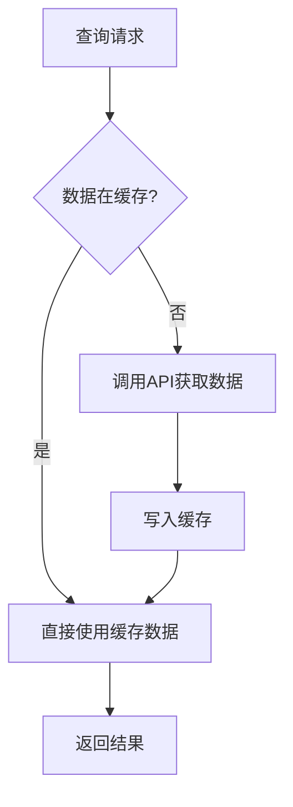

# 缓存管理策略

## 概述

本技能采用多级缓存策略减少重复调用认证接口，提升查询性能并避免触发API限流。

---

## 缓存架构



### 缓存层级

| 层级 | 数据项       | 有效期                         | 存储位置  | 失效策略 |
| ---- | ------------ | ------------------------------ | --------- | -------- |
| L1   | yxdata-token | 7小时（8小时有效期-1小时缓冲） | 内存      | TTL过期  |
| L1   | 用户信息     | 24小时                         | 内存      | TTL过期  |
| L1   | 用户权限     | 24小时                         | 内存      | TTL过期  |
| L1   | 指示器列表   | 24小时                         | 内存      | TTL过期  |
| L1   | 名称ID映射   | 24小时                         | 内存      | TTL过期  |
| L2   | 指标查询结果 | 1小时（可选）                  | 内存/文件 | TTL过期  |

---

## 实现方案

### 1. 内存缓存实现

```python
import time
from typing import Any, Dict, Optional
from threading import Lock


class CacheManager:
    """缓存管理器"""

    def __init__(self):
        self._cache: Dict[str, Dict[str, Any]] = {}
        self._lock = Lock()

    def get(self, key: str) -> Optional[Any]:
        """获取缓存值"""
        with self._lock:
            entry = self._cache.get(key)
            if entry and time.time() < entry['expire']:
                return entry['value']
            elif entry:
                # 过期删除
                del self._cache[key]
            return None

    def set(self, key: str, value: Any, ttl: int = 3600):
        """设置缓存值"""
        with self._lock:
            self._cache[key] = {
                'value': value,
                'expire': time.time() + ttl,
                'created': time.time()
            }

    def clear(self):
        """清空缓存"""
        with self._lock:
            self._cache.clear()

    def size(self) -> int:
        """缓存条目数"""
        with self._lock:
            return len(self._cache)


# 全局缓存实例
cache = CacheManager()

# 缓存key生成器
def make_key(*parts) -> str:
    """生成缓存key"""
    return ":".join(str(p) for p in parts)
```

### 2. 缓存使用示例

```python
# 用户信息缓存
def get_user_info_cached(empno: str, fetch_func) -> Dict[str, Any]:
    cache_key = f"user_info:{empno}"
    info = cache.get(cache_key)
    if info is None:
        info = fetch_func(empno)
        if info.get('status'):
            cache.set(cache_key, info, ttl=24 * 3600)  # 24小时
    return info

# 使用示例
user_info = get_user_info_cached(
    empno="00114732",
    fetch_func=lambda e: query_user_info(e, yxdata_token, token)
)
```

---

## 各数据项缓存策略

### 1. yxdata-token 缓存

```python
class AuthManager:
    def __init__(self):
        self.token_cache_key = "xxxx:global"
        self.token_expire_key = "xxxx:global"
        # 或使用实例变量（已实现）

    def get_token(self, empno: str, token: str) -> str:
        # 检查内存缓存（当前实现）
        now = time.time()
        if self.yxdata_token and now < self.token_expire:
            return self.yxdata_token

        # 过期前1小时刷新
        if self.yxdata_token and now < self.token_expire - 3600:
            return self.yxdata_token

        # 重新认证
        return self._refresh_token(empno, token)
```

**缓存键**：全局单例（无需区分用户）
**TTL**：7小时（8小时有效期-1小时缓冲）
**刷新策略**：过期前1小时自动刷新

---

### 2. 用户信息缓存

```python
def get_user_info_with_cache(empno: str, auth_func, force_refresh: bool = False):
    cache_key = f"user_info:{empno}"

    if not force_refresh:
        cached = cache.get(cache_key)
        if cached:
            return cached

    # 调用API
    result = auth_func(empno)
    if result.get('status'):
        cache.set(cache_key, result, ttl=24 * 3600)  # 24小时

    return result
```

**缓存键**：`user_info:{empno}`
**TTL**：24小时
**失效条件**：用户信息变更（需手动清除或等待TTL）

---

### 3. 用户权限缓存

```python
def get_user_auth_with_cache(empno: str, auth_func):
    cache_key = f"user_auth:{empno}"

    cached = cache.get(cache_key)
    if cached:
        return cached

    result = auth_func(empno)
    if result.get('status'):
        cache.set(cache_key, result, ttl=24 * 3600)

    return result
```

**缓存键**：`user_auth:{empno}`
**TTL**：24小时
**注意**：权限变更不会立即生效，需等待TTL或手动清除

**手动清除示例**：

```python
def revoke_user_permission(empno: str):
    """用户权限变更时调用"""
    cache.delete(f"user_info:{empno}")
    cache.delete(f"user_auth:{empno}")
```

---

### 4. 指示器列表缓存

```python
def get_indicator_list_cached(keyword: str = "", fetch_func):
    cache_key = f"indicator_list:{keyword or 'all'}"

    cached = cache.get(cache_key)
    if cached:
        return cached

    result = fetch_func(keyword)
    if result.get('status'):
        cache.set(cache_key, result, ttl=24 * 3600)

    return result
```

**缓存键**：`indicator_list:{keyword}`（keyword为空时为`all`）
**TTL**：24小时
**刷新策略**：系统管理员更新指标配置时需清除缓存

---

### 5. 名称ID映射缓存

```python
def get_dimension_id_cached(query_type: str, name: str, fetch_func):
    cache_key = f"dimension:{query_type}:{name}"

    cached = cache.get(cache_key)
    if cached:
        return cached

    result = fetch_func(query_type, name)
    if result.get('status') and result.get('data', {}).get('content'):
        info = extract_dimension_info(result)
        cache.set(cache_key, info, ttl=24 * 3600)
        return info

    return None
```

**缓存键**：`dimension:{type}:{name}`
**TTL**：24小时
**示例**：`dimension:项目组:ZXUFP`

---

### 6. 指标数据缓存（可选）

对于频繁查询且数据更新不频繁的指标，可以缓存查询结果：

```python
def get_indicator_data_cached(
    api_url: str,
    dimension_value: str,
    fetch_func,
    ttl: int = 3600  # 1小时
):
    # 生成缓存键（包含URL和ID）
    import hashlib
    key_str = f"{api_url}:{dimension_value}"
    cache_key = f"indicator_data:{hashlib.md5(key_str.encode()).hexdigest()}"

    cached = cache.get(cache_key)
    if cached:
        return cached

    result = fetch_func()
    if result.get('status'):
        cache.set(cache_key, result, ttl=ttl)

    return result
```

**缓存键**：`indicator_data:{md5(api_url+dimension_value)}`
**TTL**：1小时（配置为可调参数）
**适用场景**：实时性要求不高的报表场景

---

## 缓存失效管理

### 1. TTL自动失效

所有缓存项设置TTL，到期后自动重新获取。

### 2. 手动失效

```python
class CacheControl:
    """缓存控制接口"""

    @staticmethod
    def clear_user_cache(empno: str):
        """清除用户相关缓存"""
        keys = [
            f"user_info:{empno}",
            f"user_auth:{empno}"
        ]
        for key in keys:
            cache.delete(key)

    @staticmethod
    def clear_all_cache():
        """清除所有缓存"""
        cache.clear()

    @staticmethod
    def clear_indicator_cache(keyword: str = None):
        """清除指示器缓存"""
        if keyword:
            cache.delete(f"indicator_list:{keyword}")
        else:
            # 清除所有指示器缓存
            for key in list(cache._cache.keys()):
                if key.startswith("indicator_list:"):
                    cache.delete(key)
```

---

## 缓存监控

### 1. 缓存统计

```python
def get_cache_stats() -> Dict[str, Any]:
    """获取缓存统计信息"""
    stats = {
        'total_entries': cache.size(),
        'by_type': {},
        'hit_count': 0,
        'miss_count': 0
    }

    # 按类型统计
    for key in cache._cache.keys():
        parts = key.split(':', 1)
        if len(parts) == 2:
            cache_type = parts[0]
            stats['by_type'][cache_type] = stats['by_type'].get(cache_type, 0) + 1

    return stats
```

### 2. 缓存命中率

在CacheManager中添加计数器：

```python
class CacheManager:
    def __init__(self):
        self._cache = {}
        self._hit_count = 0
        self._miss_count = 0

    def get(self, key: str):
        entry = self._cache.get(key)
        if entry and time.time() < entry['expire']:
            self._hit_count += 1
            return entry['value']
        elif entry:
            del self._cache[key]
        self._miss_count += 1
        return None

    def hit_rate(self) -> float:
        total = self._hit_count + self._miss_count
        return self._hit_count / total if total > 0 else 0
```

---

## 分布式缓存（可选）

对于多实例部署，可考虑使用 Redis 等分布式缓存。示例仅缓存 **JSON 可序列化** 的数据（dict/list/str/number/bool/None），避免使用 `pickle`/`marshal` 反序列化来自外部或不可信来源的数据（可导致任意代码执行）。

```python
import json
import redis
from typing import Any, Optional

class RedisCache:
    def __init__(self, host: str, port: int, db: int = 0):
        self.redis = redis.Redis(host=host, port=port, db=db)

    def get(self, key: str) -> Optional[Any]:
        value = self.redis.get(key)
        if value is None:
            return None
        return json.loads(value.decode("utf-8"))

    def set(self, key: str, value: Any, ttl: int = 3600) -> None:
        payload = json.dumps(value, ensure_ascii=False).encode("utf-8")
        self.redis.setex(key, ttl, payload)
```

若业务对象无法直接 `json.dumps`，应在应用层先转为纯数据结构（或显式字段），再写入缓存；**不要**为省事对不可信字节流做 `pickle.loads`。

---

## 反序列化与安全编码（通用）

编写或审查缓存、配置、插件加载相关代码时，建议遵循：

| 不推荐                                          | 推荐做法                                                                                       |
| ----------------------------------------------- | ---------------------------------------------------------------------------------------------- |
| `eval()` / `exec()` 解析字符串                  | 结构化数据用 `json.loads()`；字面量常量用 `ast.literal_eval()`（仍只用于**可信**输入）         |
| `pickle.loads` / `marshal.loads` 处理不可信数据 | **避免**；同源、受控 Redis/文件且团队明确承担风险时再考虑，否则用 JSON/msgpack 等并校验 schema |
| `yaml.load()`                                   | `yaml.safe_load()`（禁止任意对象构造）                                                         |
| `__import__(name)` 且 `name` 来自外部           | `importlib.import_module()`，并对模块名做 **白名单** 校验（允许的字符集与前缀）                |

---

## 注意事项

1. **敏感信息**：to_user_passwd等敏感信息**不缓存**
2. **缓存穿透**：对不存在的key设置空值缓存（短TTL）
3. **缓存雪崩**：TTL增加随机抖动（±5%）
4. **并发安全**：使用锁保证线程安全
5. **内存限制**：生产环境建议设置最大缓存条目数

---

## 最佳实践

1. **按需缓存**：只缓存稳定、重复读取的数据
2. **合理TTL**：根据数据变化频率设置有效期
3. **监控告警**：缓存命中率低于阈值时告警
4. **清理机制**：定期清理过期缓存
5. **降级策略**：缓存失效时正常调用API，不阻塞流程
