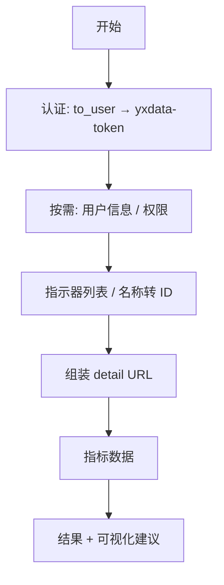

# 返回结构、场景步骤与工作流

## 统一返回骨架（示例）

```json
{
  "status": true,
  "type": "indicator_data",
  "message": "查询成功，共 29 条记录",
  "_meta": {
    "intent": "query_indicator",
    "query": "用户原始查询语句",
    "timestamp": "2026-03-29T23:44:00",
    "processor": "imap-orchestrator-v2"
  }
}
```

各意图还会包含 `indicator`、`data`、`chart`、`visualization` 等字段，以实际返回为准。

## 成功响应示例：指标查询

见 `SKILL.md` 中精简说明或本仓库 `tests/test_basic.py` 中的断言结构。典型字段：

- `indicator`：名称、描述、`api_url`、轴与图表类型等。
- `data`：分页与 `content` 行数据。
- `visualization` / `chart`：图表类型与标题轴标签建议。

## 成功响应：URL 直连

```json
{
  "status": true,
  "source": "url_direct",
  "url": "https://aip.zte.com.cn/dashboard/...",
  "data": {}
}
```

## 错误响应

```json
{
  "status": false,
  "error": "错误原因描述",
  "code": 0,
  "suggestion": "建议的解决方式"
}
```

## 典型场景步骤

### 项目组 MR 交付周期

1. 读取 `coclaw_empno` / `coclaw_token`。
2. 获取公共账户口令 → 登录得 `yxdata-token`（链路内使用）。
3. 用户信息 / 权限校验（按需）。
4. 指示器列表匹配指标名 → 取 `api_接口地址`。
5. 名称转 ID → 拼 `detail` 查询参数与时间范围。
6. 返回数据与可视化建议。

### 部门代码产出（带时间窗）

将 `query_type` 设为部门，`query_name` 为部门名，并传 `start_date` / `end_date`。

### URL 取数

1. 识别或解码 URL。
2. 调用免鉴权接口 `get_indicator_data_by_url`（无需 `yxdata-token`）。
3. 返回数据。

## 查询工作流（逻辑）



说明：当前实现**不做跨请求持久化缓存**；`yxdata-token` 等在单次调用/编排器实例生命周期内复用即可。

## 脚本级实现说明

业务逻辑以 `scripts/*.py` 与包入口 `imap_indicator_query` 为准，**勿在文档中维护大段重复源码**；接口契约以 `references/api_docs.md` 为准。
